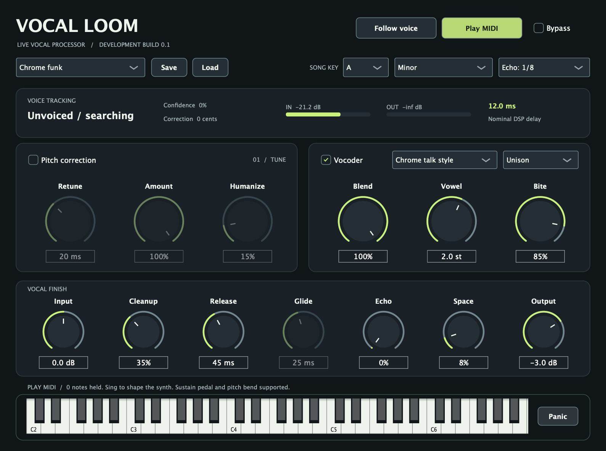

# Vocal Loom v0.1

A native Mac vocal processor created for Anthony Jones, prioritizing live singing with low latency. This repository contains the editable C++ project, tests, documentation, interface previews and synthetic audio examples.



## Features

- Independent pitch correction and vocoder switches.
- Interchangeable voice-follow and MIDI keyboard control.
- Eight-voice MIDI carrier with chords, velocity, sustain, pitch bend and panic.
- A 24-band vocoder and a brighter, talk-box-inspired Chrome character.
- Song key/scale selection, retune speed, correction amount and humanize.
- Vocal cleanup, stereo tempo-synced echo, reverb, input/output metering and a soft ceiling.
- Host automation, session recall, factory presets and user preset Save/Load.
- AU, VST3 and standalone targets for Apple Silicon Mac.

## Development status

This is a development prototype. Three automated test groups pass, including direct rendering of the compiled AU interface at 44.1, 48 and 96 kHz. The unshifted path measures 12 ms nominal plug-in delay; voice tracking, the audio interface and host buffering add response time.

The tuner uses an initial granular shifting engine and does not yet preserve vocal formants. Real-singer listening tests, full Apple auval validation, and an actual FL Studio live session remain pending. The Chrome mode is inspired by talk-box articulation; no artist recordings, samples or voices are included.

The complete source/build ZIP is backed up as a **draft development release**, visible to repository maintainers. Public binary distribution licensing is not finalized. This repository does not select a license for the owner's original code; JUCE and dependency notices are retained in the project.

## Build

Requires Xcode or Command Line Tools, Git and CMake 3.22+. The initial configure downloads the pinned JUCE 8.0.12 dependency.

```sh
cmake -S VocalLoom -B work/build -DCMAKE_BUILD_TYPE=Release -DCMAKE_OSX_ARCHITECTURES=arm64
cmake --build work/build -j 6
ctest --test-dir work/build --output-on-failure
```

Build artifacts appear in `work/build/VocalLoom_artefacts/Release/`. An existing JUCE checkout can be supplied with `-DJUCE_DIR=/absolute/path/to/JUCE`.

## Project files

- [Setup, signal behavior and limitations](VocalLoom/README.md)
- [Validation report](VocalLoom/docs/Validation.md)
- [Third-party licensing notes](VocalLoom/THIRD_PARTY.md)
- [DSP source](VocalLoom/Source/DSP.h)
- [Tests](VocalLoom/Tests)
- [Synthetic audio examples](AudioExamples)

Compiled bundles, build caches and local credentials are excluded from Git. The draft release ZIP contains the source, AU/VST3/standalone builds, installer, previews and synthetic audio examples.
